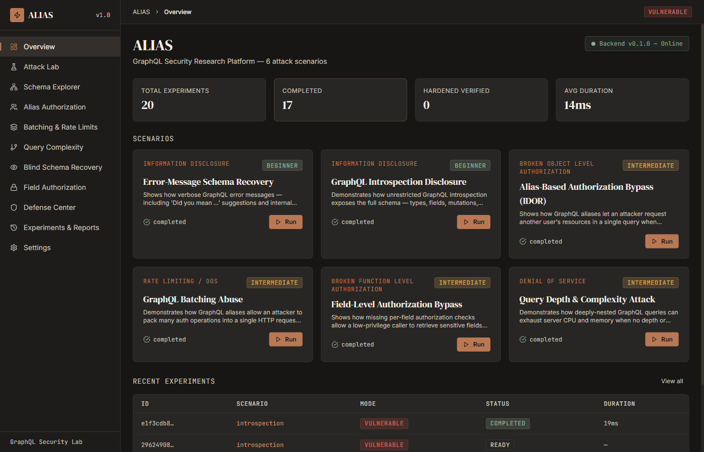
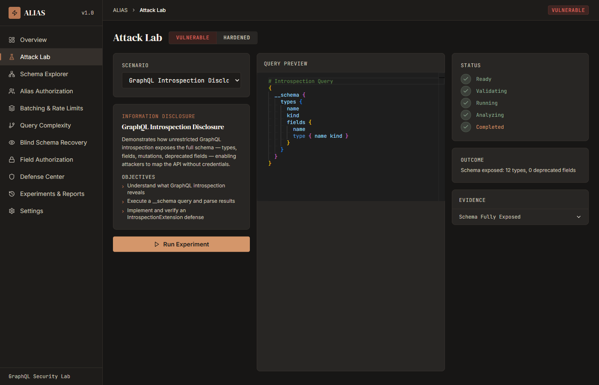
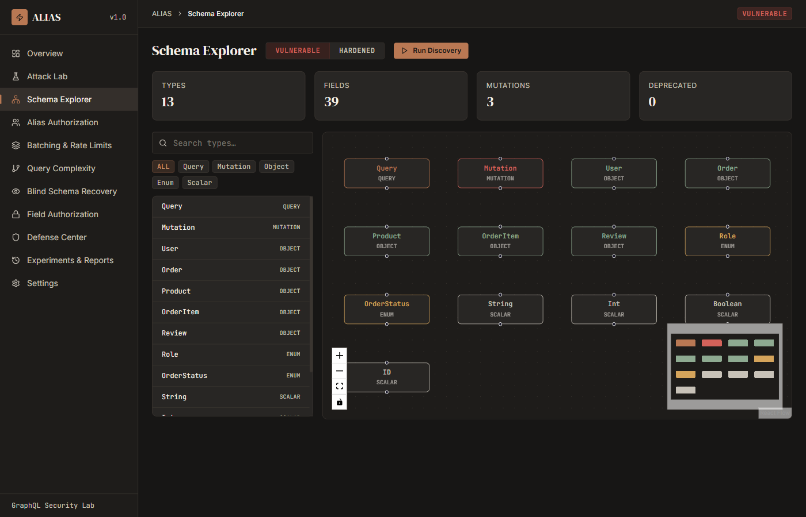
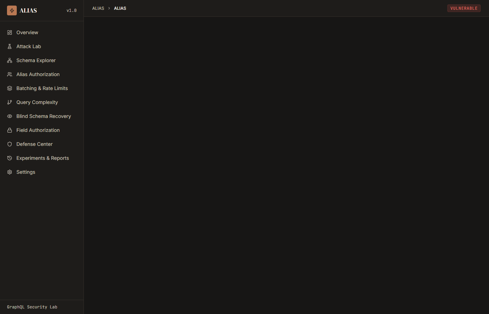
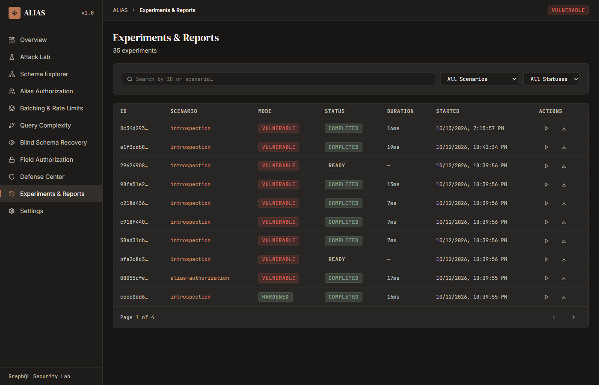

# ALIAS — GraphQL Security Research Platform

<div align="center">


**One endpoint. A universe of attack surfaces.**

*An offline-capable GraphQL security research platform for understanding and demonstrating six classes of GraphQL vulnerability — each with a deliberately vulnerable implementation alongside a hardened counterpart.*

</div>

<div align="center">



</div>

---

## Overview

GraphQL's flexible query language creates a broad attack surface that HTTP-level controls don't address. ALIAS gives you a contained, self-hosted lab where you can run real attacks, observe real behavior, and compare it against effective defenses — all without touching production systems.

Every scenario ships two Strawberry GraphQL schemas: one intentionally insecure, one hardened. The experiment engine runs both sides, captures evidence, and lets you export structured reports.

---

## Scenarios

| # | Scenario | Attack Class | Difficulty |
|---|----------|-------------|------------|
| 1 | **Schema Introspection Disclosure** | Information Disclosure | Beginner |
| 2 | **Alias-Based Authorization Bypass (IDOR)** | Broken Object Level Auth | Intermediate |
| 3 | **GraphQL Batching Abuse** | Rate Limiting / DoS | Intermediate |
| 4 | **Query Depth & Complexity Attack** | Denial of Service | Intermediate |
| 5 | **Blind Schema Recovery** | Information Disclosure | Advanced |
| 6 | **Field-Level Authorization Bypass** | Broken Function Level Auth | Intermediate |

Each scenario provides:

- **Vulnerable mode** — intentionally insecure lab endpoint that demonstrates the exact failure
- **Hardened mode** — same endpoint with the defensive control applied and verified
- **Evidence capture** — structured evidence (queries, responses, timing) per run
- **Defense verification** — automated check that the control is active and effective
- **Exportable reports** — JSON, CSV, and HTML

---

## UI

### Overview & Scenario Dashboard

The overview page surfaces live metrics and all six scenario cards with difficulty ratings and run status. Each card links directly to its dedicated research page.

### Attack Lab

The Attack Lab is the centrepiece — a Monaco-powered query editor, a real-time status pipeline (Ready → Validating → Running → Analyzing → Completed), and a structured evidence panel. Switch between `VULNERABLE` and `HARDENED` modes with a single click and compare results side by side.



### Schema Explorer

React Flow graph of the live schema — nodes for types, edges for field relationships. Filter by Query / Mutation / Object / Enum / Scalar, search by name, and toggle between vulnerable and hardened schemas to see how the defense rewires the graph.



### Defense Center

Catalog of all six defensive controls with one-click verification. Each verification run returns structured proof that the control is active — not just "it should work" but "here is the blocked request and the error it produced."



### Experiments & Reports

Full history of every run across all scenarios, filterable by scenario, mode, and status. Export any experiment as JSON, CSV, or HTML.



---

## Architecture

```
Frontend (React 18 + Vite)       http://127.0.0.1:5173
          │
          │  REST /api/*
          ▼
Backend (FastAPI)                 http://127.0.0.1:8000
          │
          ├── /api/health
          ├── /api/scenarios
          ├── /api/experiments
          ├── /api/defenses
          ├── /api/reports/{id}
          │
          └── /lab/{scenario}/{mode}/graphql   ← live GraphQL lab endpoints
                    │
                    ▼
          Experiment Engine (asyncio, semaphore, timeout)
                    │
                    ▼
          Scenario Modules (introspection / alias_authorization / ...)
                    │
                    ▼
          Strawberry GraphQL schemas (per scenario × per mode)
                    │
                    ▼
          SQLite (alias.db)  —  experiment history, settings
```

**Backend:** FastAPI · Strawberry GraphQL 0.334 · aiosqlite · Pydantic v2 · pydantic-settings  
**Frontend:** React 18 · TypeScript · Vite · Tailwind CSS · TanStack Query · Axios · Monaco Editor · React Flow · Recharts · Framer Motion  
**Database:** SQLite (WAL mode) — loopback, file-local, no server required  
**Network:** All binding is `127.0.0.1` only — not exposed to the network by default

---

## Requirements

- Python 3.12+
- Node.js 20+
- npm 9+

---

## Quick Start

```bash
git clone https://github.com/het-P301204/alias.git
cd alias
python scripts/setup.py
python scripts/dev.py
```

`setup.py` installs Python dependencies, npm packages, and seeds the database.  
`dev.py` launches both servers concurrently.

Open **http://127.0.0.1:5173** — the backend health indicator in the top-right corner turns green when the API is reachable.

### Manual start

```bash
# Backend (terminal 1)
uvicorn alias_core.api.main:app --reload

# Frontend (terminal 2)
cd frontend && npm run dev
```

---

## CLI

```bash
# Environment check
alias doctor

# List available scenarios
alias lab list

# Run a scenario
alias test run --scenario introspection
alias test run --scenario alias-authorization --mode hardened

# Compare vulnerable vs hardened side by side
alias test compare --scenario batching

# Reports
alias report list
alias report export --id <uuid> --format html
alias report export --id <uuid> --format json
alias report export --id <uuid> --format csv
```

---

## Tests

```bash
# Full backend suite (127 tests)
pytest backend/tests/ -v

# All at once
pytest backend/tests/ -v && cd frontend && npm test -- --run
```

---

## Project Layout

```
alias/
├── backend/
│   └── alias_core/              # Python package
│       ├── api/                 # FastAPI routes and middleware
│       ├── config/              # pydantic-settings
│       ├── database/            # aiosqlite models, init, queries
│       ├── experiments/         # engine, registry, Pydantic models
│       ├── graphql/             # lab router — mounts per-scenario schemas
│       ├── reporting/           # JSON / CSV / HTML report generator
│       ├── security/            # depth/complexity SchemaExtensions
│       └── cli/                 # Typer CLI (alias command)
├── scenarios/                   # One package per scenario
│   ├── introspection/
│   ├── alias_authorization/
│   ├── batching/
│   ├── query_complexity/
│   ├── blind_recovery/
│   └── field_authorization/
├── frontend/
│   └── src/
│       ├── features/            # 11 page components
│       ├── components/          # shared UI + visualizations
│       ├── hooks/               # TanStack Query hooks
│       └── services/            # Axios API client
├── backend/tests/               # pytest suite
├── docs/                        # extended documentation
├── scripts/
│   ├── setup.py                 # one-command setup
│   └── dev.py                   # concurrent dev server launcher
├── pyproject.toml
└── alias.db                     # created at runtime (gitignored)
```

---

## Documentation

| Document | Content |
|----------|---------|
| [docs/architecture.md](docs/architecture.md) | Service diagram, database schema, scenario lifecycle |
| [docs/installation.md](docs/installation.md) | Step-by-step for Windows, macOS, Linux |
| [docs/api.md](docs/api.md) | All REST endpoints with request/response examples |
| [docs/scenarios.md](docs/scenarios.md) | Vulnerability details and attack payloads per scenario |
| [docs/defenses.md](docs/defenses.md) | Defensive controls and how to verify them |
| [docs/threat-model.md](docs/threat-model.md) | Trust boundaries, mitigations, residual risks |
| [docs/troubleshooting.md](docs/troubleshooting.md) | Common problems and fixes |

---

## Security

This platform runs intentionally vulnerable lab services. All endpoints bind to loopback (`127.0.0.1`) only. Fixture credentials and data are entirely synthetic. See [SECURITY.md](SECURITY.md) for the full safety policy.

---

## License

MIT — see [LICENSE](LICENSE)
